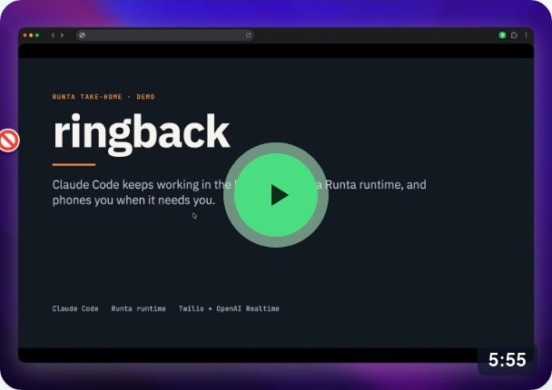
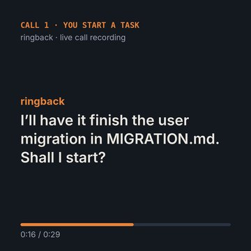
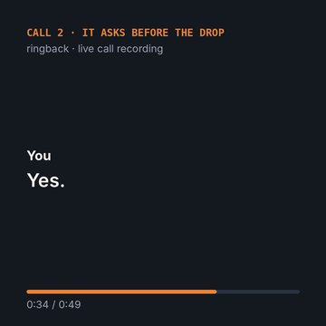
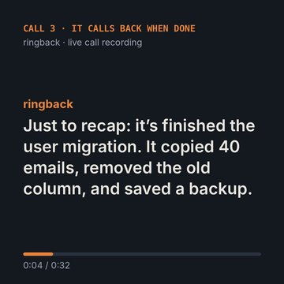

# ringback

**A coding agent that keeps working in the background, and phones you when it needs you.**

**[Demo page](https://jayakrishna-g.github.io/ringback/)** · [Demo video](https://cursorful.com/share/5XEEtgLzZY9b) · [Memo (PDF)](MEMO.pdf) · [Recorded calls](docs/calls/README.md) · [Runta findings](FINDINGS.md)

<a href="https://jayakrishna-g.github.io/ringback/#video"></a>

ringback runs Claude Code on a [Runta](https://runta.com) runtime and gives it a phone number.
You give it work by phone, hang up, and get on with your day. It calls you only when it needs you:

* **before a risky command.** It holds `DROP COLUMN`, `rm -r`, force-push or `terraform apply`,
  reads it to you, and runs it only on your yes;
* **when it's stuck on a decision only you can make**, such as "Should I use the staging DB?";
* **when it's finished, or has failed**, with a short summary.

You can also call it any time to start a task, ask what it's doing, or redirect it.

## Hear it: three real calls from one run

<table>
<tr>
<td align="center" width="33%"><a href="https://jayakrishna-g.github.io/ringback/#call-1"></a><br><b>1 · Owner starts a task</b><br>Read back, then Claude Code starts · 0:30</td>
<td align="center" width="33%"><a href="https://jayakrishna-g.github.io/ringback/#call-2"></a><br><b>2 · It asks before the DROP</b><br>The owner asks what it will run, then approves · 0:50</td>
<td align="center" width="33%"><a href="https://jayakrishna-g.github.io/ringback/#call-3"></a><br><b>3 · It calls back when done</b><br>A summary, including what isn't committed · 0:32</td>
</tr>
</table>

Click a call to play it with sound on the [demo page](https://jayakrishna-g.github.io/ringback/#calls). Captioned recordings from 18 Nov 2026; [docs/calls](docs/calls/README.md) has the MP4s, transcripts and the server's log for the same run.

## How it fits with Runta

Runta's controls are set before the run: an **egress allowlist** (OpenAI, Anthropic, Twilio,
Runta only), **secret stubs** so API keys never enter the runtime, and **tool I/O capture** of
every tool call. None of them can stop *this* command *now* and ask a person. ringback adds
that, and before an approved irreversible step it takes a **Runta checkpoint** so the step can
be rolled back. More in [docs/DESIGN.md](docs/DESIGN.md).

## Quickstart

```bash
git clone https://github.com/jayakrishna-g/ringback.git && cd ringback
python3 -m venv .venv && .venv/bin/pip install -e '.[dev]'
.venv/bin/python -m pytest -q        # 120 tests, no network, no keys
```

To try it on your own phone (Runta, Twilio, OpenAI and Anthropic accounts; about 15 minutes),
follow [docs/SETUP.md](docs/SETUP.md).

## Docs

| Doc | What's in it |
|---|---|
| [Demo page](https://jayakrishna-g.github.io/ringback/) | The demo video and the three recorded calls, playable in the browser |
| [MEMO.pdf](MEMO.pdf) | The 2-page report: what, why, evidence, what I cut |
| [docs/SETUP.md](docs/SETUP.md) | Full setup, testing it by phone, operating it, using the CLI from other agents |
| [docs/DESIGN.md](docs/DESIGN.md) | Architecture, why Runta, how Claude Code runs, what's real vs mocked, file layout |
| [docs/SECURITY.md](docs/SECURITY.md) | Threat model and known gaps |
| [FINDINGS.md](FINDINGS.md) | What I measured about Runta along the way |
| [docs/calls/](docs/calls/README.md) | Captioned call recordings, transcripts and the matching server log |
| [docs/ringback_demo_deck.html](docs/ringback_demo_deck.html) | The demo slide deck (download and open in a browser) |

ringback is built for an agent that makes mistakes, not a hostile one: the risky-command check
is a guardrail, not a sandbox. [docs/SECURITY.md](docs/SECURITY.md) says exactly what is and
isn't enforced.
